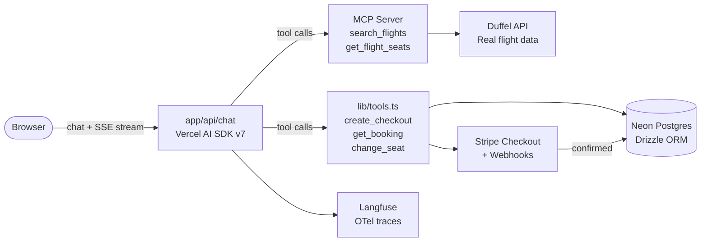

# TravelChat

[](https://github.com/Suma-Yogaraja/travel-chat-app/actions/workflows/ci.yml)

**Live demo → [travel-chat-app-wine.vercel.app](https://travel-chat-app-wine.vercel.app)**

A chat-based travel app where users search for flights, book tickets, and manage seats through conversation with an AI assistant.

Built as a learning project to understand core AI engineering concepts: MCP servers, LLM tool calling, streaming, hooks, skills as `.md` files, real flight APIs, and Stripe payments.

## What it does

- **Search flights** — ask in natural language, the AI calls the search tool automatically
- **View seat maps** — interactive seat picker rendered directly in the chat
- **Book tickets** — everyone pays via Stripe Checkout; guests verify email with OTP first, auth users book directly
- **Pay securely** — webhook confirms payment before booking is saved; Pay button appears in chat
- **Change seats** — update your seat on any existing booking
- **Cancel bookings** — cancel from the My Bookings page
- **Guest mode** — chat without signing in; bookings saved with a GS- reference
- **Authenticated mode** — sign in with GitHub, Google, or email/password to save and resume conversations

## Tech stack

| Layer | Tool |
|---|---|
| Framework | Next.js 16 App Router |
| AI | Vercel AI SDK v7 |
| Model | Claude Haiku `claude-haiku-4-5-20251001` via `@ai-sdk/anthropic` |
| MCP | `@modelcontextprotocol/sdk` (InMemoryTransport) |
| Auth | NextAuth v5 — GitHub OAuth, Google OAuth, Credentials |
| Database | Neon Postgres |
| ORM | Drizzle ORM |
| Flight data | Duffel API (sandbox) — fallback to mock via `FLIGHT_PROVIDER=mock` |
| Payments | Stripe Checkout (hosted page) + webhooks |
| Email | Nodemailer + Gmail |
| Observability | Langfuse (`@langfuse/vercel-ai-sdk` + `@langfuse/otel`) |
| Styling | Tailwind CSS v4 |
| Testing | Vitest (130 unit/contract tests across 3 layers + PostgreSQL integration) |

## Architecture



## Example conversation (authenticated user)

> **You:** Find me flights from London to New York next Friday
>
> *[AI calls `search_flights` → flight cards appear]*
>
> **You:** I'll take the second one. Show me the seats.
>
> *[AI calls `get_flight_seats` → seat map appears]*
>
> **You:** Book seat 12A for Sarah Connor
>
> **Assistant:** Just to confirm — Flight LHR→JFK, seat 12A, Sarah Connor, $412. Shall I proceed?
>
> **You:** Yes
>
> *[AI calls `create_checkout` → Pay button appears in chat]*
>
> **Assistant:** Click Pay to complete your booking securely via Stripe. Your reference is BK-1234567890-ab.
>
> *[User clicks Pay → Stripe checkout → test card → redirected to /booking/success → confirmed]*

## Key concepts demonstrated

- **MCP server** (`mcp-server/`) — custom server exposing travel tools; connected in-process via `InMemoryTransport` (no subprocess)
- **Tool calling** — AI decides when to call `search_flights`, `create_checkout`, etc. based on the conversation
- **Role-based tools** — guests get OTP + booking tools; authenticated users get `create_checkout`, `get_booking`, `change_seat`
- **Streaming** — responses stream token by token via `streamText` + `toUIMessageStreamResponse`
- **Skills as `.md` files** — `skills/` folder loaded into the system prompt; rules for search, booking, and seat management
- **Adapter pattern** — swap mock flight data for Duffel (or any real API) via `FLIGHT_PROVIDER` env var, zero code changes
- **Server-authoritative pricing** — model passes `offerId` (UUID), backend re-validates price with Duffel before charging. Model can never supply or influence the price. Fail-closed: if Duffel is unreachable, checkout is refused.
- **Guest session cookie** — HttpOnly `guest-session-id` cookie ties search offers to the guest who created them. UUID alone is not authorization; matching cookie required.
- **PaymentProvider adapter** — `lib/payment-provider.ts` interface isolates Stripe behind a boundary. Tests inject a fake; production uses `lib/stripe-payment-provider.ts`.
- **Stripe webhooks as source of truth** — booking is only confirmed when the `checkout.session.completed` webhook fires, never on browser redirect
- **Webhook idempotency** — app-level `paymentStatus === "pending"` guard + SQL `WHERE paymentStatus = 'pending'` as final defence
- **Circuit breaker** — `lib/stripe.ts` opens after 3 consecutive Stripe failures, auto-recovers after 60s
- **Fallback seat map** — when Duffel returns no seatmap (sandbox limitation), a deterministic layout is generated from the flight ID
- **Global API handler** — `lib/api-handler.ts` wraps every route; consistent error format, centralised logging
- **LLM observability** — Langfuse v5 stack captures tool traces, token costs, and latency per conversation
- **JSONB message storage** — full `UIMessage` objects stored in Postgres so tool call history survives refresh
- **Simulated booking** — Stripe payment succeeds, booking is confirmed in DB, email sent. No real airline reservation is issued via Duffel. Disclaimer shown in the success page and all email templates.

## Project structure

```
travel-chat-app/
├── CLAUDE.md                        # Architecture rules for Claude Code
├── mcp-server/
│   ├── CLAUDE.md                    # MCP-specific rules
│   └── index.ts                     # search_flights, get_flight_seats (+ fallback seat map)
├── skills/
│   ├── flight-search.md             # Rules: when to call search, date validation
│   ├── booking.md                   # Rules: Stripe flow (auth + guest), price-change handling
│   └── seat-management.md           # Rules: seat maps, guest OTP for changes
├── lib/
│   ├── api-handler.ts               # Global error handler HOF + AppError class
│   ├── auth.ts                      # NextAuth config (GitHub + Google + Credentials)
│   ├── email.ts                     # Nodemailer helpers (booking confirm, OTP, reset, seat change, cancel)
│   ├── stripe.ts                    # Stripe client singleton + circuit breaker + live key guard
│   ├── payment-provider.ts          # PaymentProvider interface + CheckoutParams type
│   ├── stripe-payment-provider.ts   # Stripe implementation of PaymentProvider
│   ├── guest-session.ts             # getOrCreateGuestSession() — HttpOnly cookie, 24h
│   ├── chat-history.ts              # searchFlightsPlaceholder() — extracts F1=<uuid> for context trimmer
│   ├── booking-status.ts            # getBookingPaymentStatus() — pure mapping function
│   ├── rate-limit.ts                # Sliding-window rate limiter (20 req/min per IP)
│   ├── tools.ts                     # createTravelTools(TravelToolsContext) — create_checkout, OTP tools, get_booking, change_seat
│   ├── mcp-bridge.ts                # Connects MCP server in-process, binds McpContext per request
│   ├── langfuse-processor.ts        # Singleton LangfuseSpanProcessor
│   ├── offers/
│   │   ├── offer-service.ts         # validateOfferForCheckout(), persistFlightOffer(), ownership enforcement
│   │   ├── offer-repository.ts      # DB queries for flight_offers table
│   │   └── price-confirmation.ts    # HMAC-SHA256 priceChangeToken generation/verification
│   ├── db/
│   │   ├── schema.ts                # Drizzle table definitions (incl. flight_offers)
│   │   ├── queries.ts               # Typed DB helpers (atomic OTP: UPDATE WHERE usedAt IS NULL)
│   │   └── index.ts                 # Drizzle client (Neon HTTP)
│   └── flight-provider/
│       ├── index.ts                 # FlightProvider interface + factory
│       ├── duffel-provider.ts       # Duffel API implementation (active)
│       └── mock-provider.ts         # Hardcoded mock data (fallback)
├── app/
│   ├── api/
│   │   ├── chat/route.ts            # Main AI streaming route
│   │   └── stripe/
│   │       ├── webhook/route.ts     # Stripe webhook — confirms/expires bookings (source of truth)
│   │       └── status/route.ts      # Polling endpoint for success page
│   ├── booking/
│   │   └── success/page.tsx         # Payment confirmation page (polls status, shows simulated-booking disclaimer)
│   ├── chat/
│   │   ├── [id]/page.tsx            # Authenticated conversation
│   │   ├── guest/page.tsx           # Guest mode
│   │   └── bookings/                # My Bookings page
│   ├── login/ register/ forgot-password/ reset-password/
│   └── global-error.tsx
├── components/
│   └── chat/
│       ├── pay-button.tsx           # Pay button card rendered on create_checkout output
│       ├── seat-map.tsx             # Interactive seat picker
│       └── flight-results.tsx       # Flight cards with offerId attached
└── tests/
    ├── layer1-tool-logic/           # Unit tests — pure functions, no DB (booking-lifecycle, currency, price-confirmation)
    ├── layer2-mcp-contract/         # Contract tests — offer ownership, tool schemas, webhook, checkout (130 tests)
    ├── layer3-llm/                  # LLM tests — real Claude Haiku (require RUN_LLM_TESTS=1 + ANTHROPIC_API_KEY)
    └── integration/
        └── otp-atomicity.test.ts    # PostgreSQL concurrency test (requires TEST_DATABASE_URL)
```

## What's real vs mocked

| Feature | In sandbox | In production |
|---|---|---|
| Flight search | Real (Duffel sandbox) | Real |
| Seat maps | Real for Duffel Airways + AA test flights; generated fallback for others | Real for all airlines |
| Payments | Stripe test mode (no real charges) | Stripe live mode |
| Email | Real (Gmail SMTP) | Real |
| Auth | Real (GitHub/Google OAuth) | Real |

## Getting started

### 1. Install dependencies

```bash
npm install
```

### 2. Set up environment variables

```bash
cp .env.local.example .env.local
```

Fill in:
- `ANTHROPIC_API_KEY` — from [console.anthropic.com](https://console.anthropic.com)
- `DATABASE_URL` — Neon Postgres connection string from [neon.tech](https://neon.tech)
- `NEXTAUTH_SECRET` — run `openssl rand -base64 32`
- `NEXTAUTH_URL` — `http://localhost:3002` in development
- `GITHUB_ID` + `GITHUB_SECRET` — GitHub OAuth app, callback: `http://localhost:3002/api/auth/callback/github`
- `GOOGLE_CLIENT_ID` + `GOOGLE_CLIENT_SECRET` — Google OAuth app, callback: `http://localhost:3002/api/auth/callback/google`
- `GMAIL_USER` + `GMAIL_APP_PASSWORD` — Gmail account for OTP and booking confirmation emails
- `DUFFEL_API_KEY` — from [duffel.com](https://duffel.com) (free sandbox, token starts with `duffel_test_...`)
- `FLIGHT_PROVIDER` — `duffel` for real data, `mock` for local dev without a Duffel account
- `STRIPE_SECRET_KEY` + `STRIPE_WEBHOOK_SECRET` — from [dashboard.stripe.com](https://dashboard.stripe.com) (test keys)
- `LANGFUSE_SECRET_KEY` + `LANGFUSE_PUBLIC_KEY` + `LANGFUSE_BASEURL` — from [cloud.langfuse.com](https://cloud.langfuse.com) (free tier)

### 3. Push the database schema

```bash
npx drizzle-kit push
```

### 4. Run the dev server

```bash
npm run dev
```

Open [http://localhost:3002](http://localhost:3002).

### 5. (Optional) Test Stripe webhooks locally

Install the Stripe CLI, then:

```bash
stripe listen --forward-to localhost:3002/api/stripe/webhook
```

Copy the printed `whsec_...` key into `STRIPE_WEBHOOK_SECRET`.

### 6. Run tests

```bash
# Unit + contract tests (no network, no DB)
npx vitest run tests/layer1-tool-logic tests/layer2-mcp-contract

# LLM tests — costs real Anthropic credits, opt-in
RUN_LLM_TESTS=1 npx vitest run tests/layer3-llm

# PostgreSQL concurrency integration test — use a test/dev DB, never production
TEST_DATABASE_URL=<neon-url> npx vitest run tests/integration
```

`TEST_DATABASE_URL` must be set explicitly for the integration test — using `DATABASE_URL` (which might point to your dev or production DB) is intentionally blocked.

## How it works

**Guest mode** (`/chat/guest`) — messages live in React state only. Refresh = start over. Email OTP verification required before booking.

**Authenticated mode** (`/chat/[id]`) — each message saved to Postgres as a full `UIMessage` JSONB object. Conversations truly resume because tool call history is preserved.

**Payments** — both guests and authenticated users go through Stripe Checkout. Claude calls `create_checkout` (guests must pass their verified OTP), a Pay button appears in the chat. The Stripe webhook is the source of truth — it confirms the booking in the DB and sends a confirmation email. Cancelled or abandoned checkouts redirect back to the chat (not the login page).

**Flight data** — Duffel sandbox is active by default (`FLIGHT_PROVIDER=duffel`). Most airlines in sandbox don't return seatmap data — the app generates a deterministic fallback layout so the seat picker always works. Set `FLIGHT_PROVIDER=mock` for offline development.

## Switching to Groq (free tier)

Change two lines in `app/api/chat/route.ts`:

```ts
// From:
import { anthropic } from "@ai-sdk/anthropic";
model: anthropic("claude-haiku-4-5-20251001")

// To:
import { groq } from "@ai-sdk/groq";
model: groq("llama-3.3-70b-versatile")
```

Note: avoid `openai/gpt-oss-120b` — it has an 8000 TPM free-tier limit that seat maps exhaust. Claude follows skill instructions more reliably and is recommended.
